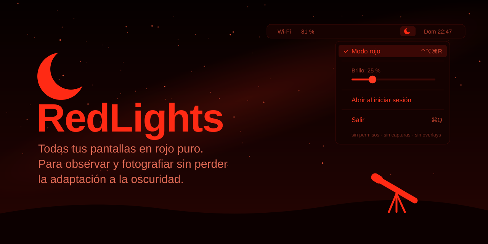

<p align="center">
  
</p>

<p align="center">
  <a href="https://github.com/Vasallo94/redlights/releases/latest"></a>
  
  <a href="LICENSE"></a>
</p>

<p align="center"><b>English</b> · <a href="README.es.md">Español</a></p>

**RedLights** turns every display pure red for astronomy and astrophotography. Green and blue go to zero and red dims as low as you need, even below the panel's minimum brightness, so you can use your laptop next to the telescope (planetarium, capture, guiding, charts) without losing your night vision.

It changes the colors the display itself outputs: no screen capture, no overlay windows, no special permissions. Everything turns red, the cursor included, and normal colors come back when you turn it off.

- **macOS**: menu bar app with a global shortcut (⌃⌥⌘R) and a brightness slider.
- **Linux and Windows**: a small command-line tool, `redlights`.

## Install

### macOS

Requires macOS 13 or later. Universal binary for Apple Silicon and Intel.

```bash
brew install --cask vasallo94/tap/redlights
```

Without Homebrew, download `RedLights-x.y.z.zip` from the [latest release](https://github.com/Vasallo94/redlights/releases/latest) and drag `RedLights.app` to Applications. The app is not notarized, so macOS blocks it the first time: open **System Settings → Privacy & Security** and click **Open Anyway**, or run `xattr -dr com.apple.quarantine /Applications/RedLights.app`.

### Linux

Works on X11 (any desktop, including KDE Plasma on X11), GNOME on Wayland or X11, and wlroots compositors: Sway, Hyprland, Wayfire, river, niri and labwc, the Raspberry Pi OS desktop.

```bash
curl -L https://github.com/Vasallo94/redlights/releases/latest/download/redlights-linux-x86_64.tar.gz | tar -xz
sudo install redlights /usr/local/bin/
```

For ARM64, such as a Raspberry Pi 4 or 5 with a 64-bit OS, download `redlights-linux-aarch64.tar.gz` instead.

### Windows

Windows 10 or 11, 64-bit. Download [`redlights-windows-x64.zip`](https://github.com/Vasallo94/redlights/releases/latest/download/redlights-windows-x64.zip), unzip it and run `redlights.exe`. The executable is not signed, so SmartScreen may warn you the first time: choose **More info → Run anyway**.

### Verifying downloads

Every release file has a SHA-256 checksum and a GitHub provenance attestation that ties it to the source and build that produced it. See [SECURITY.md](SECURITY.md#verifying-downloads) for how to check them, and for the current state of code signing.

## Usage

### macOS

| Action | How |
|---|---|
| Toggle red mode | **⌃⌥⌘R** from any app, or the moon icon in the menu bar |
| Adjust brightness | Slider in the menu. The Mac's brightness keys still work and stack with it |
| Start automatically | **Open at Login** in the menu |

### Linux and Windows

```bash
redlights          # red at 50% brightness until you press Ctrl-C
redlights 0.3      # brightness from 0 to 1, same curve as the Mac slider
redlights reset    # restore normal colors if a display was left red
```

On Windows you can also double-click `redlights.exe`: the screen stays red while its window is open, and closing the window restores normal colors.

## Why red?

At night you see with the rods in your retina. They need 20 to 30 minutes to fully adapt to the dark, and a flash of white light undoes that in seconds. Rods are barely sensitive to long-wavelength red light, so a dim red screen can be read without spoiling your dark adaptation. That is why astronomy flashlights are red.

Night Shift and dark mode are not enough: they still emit green and blue, which is what hurts night vision the most.

## How it works

Displays pass every color through a lookup table (gamma table) or a color matrix just before it reaches the panel. RedLights replaces it so that red goes from 0 to your brightness level and green and blue always stay at 0. Because the change happens after everything has been drawn, it applies to all apps, video and the cursor.

Each operating system exposes this differently:

| Platform | Mechanism | Restored automatically if RedLights crashes |
|---|---|---|
| macOS | Gamma table, `CGSetDisplayTransferByFormula` | Yes |
| Linux, wlroots | Wayland protocol `wlr-gamma-control` | Yes |
| Linux, GNOME | Mutter display D-Bus API, `SetCrtcGamma` | No, run `redlights reset` |
| Linux, X11 | XRandR gamma ramps | No, run `redlights reset` |
| Windows | Magnification API color matrix, `MagSetFullscreenColorEffect` | Yes |

The Mac app is a single Swift file, [`Sources/main.swift`](Sources/main.swift). The Linux and Windows tool, in [`rust/`](rust/), has a shared core and one backend per mechanism; the design notes are in [`docs/linux.md`](docs/linux.md).

## Known limitations

- Screenshots show normal colors, because the change is applied after the image is composed.
- KDE Plasma on Wayland is not supported yet. A KDE X11 session works.
- HDR and XDR reference display modes may ignore or reset the gamma table. Not tested yet.
- On older Intel Macs the hardware cursor may bypass the gamma table and stay white. On Apple Silicon it turns red.
- The Linux and Windows versions have been tested on CI machines and virtual displays. Reports from real hardware are very welcome: please [open an issue](https://github.com/Vasallo94/redlights/issues).

## Roadmap

- [x] macOS menu bar app
- [x] Linux: X11, GNOME, wlroots
- [x] Windows
- [ ] KDE Plasma on Wayland
- [ ] Tray icon and global shortcut on Linux and Windows
- [ ] Luminance mode: red follows the brightness of each color, so blue or green text stays readable
- [ ] Choose which displays turn red, for example laptop red and external monitor off
- [ ] Turn on automatically at astronomical twilight for your location

## Contributing

Bug reports, test reports from real hardware and pull requests are welcome. [Open an issue](https://github.com/Vasallo94/redlights/issues/new/choose) using one of the forms, or read [CONTRIBUTING.md](CONTRIBUTING.md) to set up the project, run the tests and send a pull request. Everyone taking part is expected to follow the [code of conduct](CODE_OF_CONDUCT.md).

## License

[MIT](LICENSE) © Vasallo94
